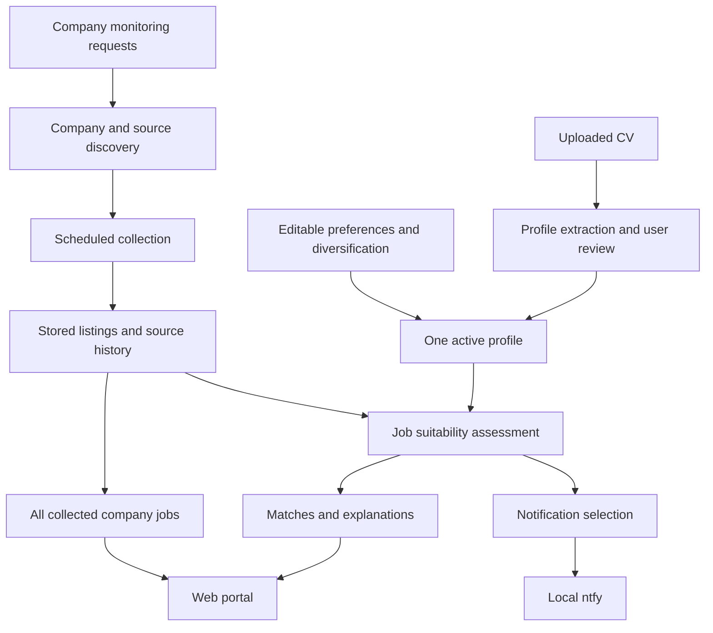
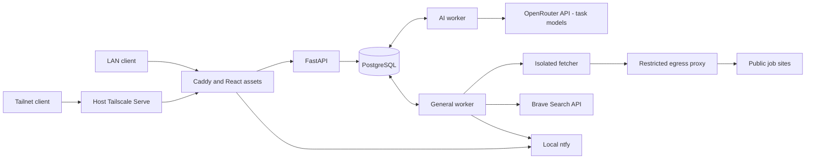

# Conceptual architecture

This document maps logical responsibilities. Concrete services and stack are selected in [IMPLEMENTATION.md](IMPLEMENTATION.md) and [DEPLOYMENT.md](DEPLOYMENT.md); tables and invariants are in [DATA_MODEL.md](DATA_MODEL.md).

## Information flow

## Responsibilities

| Area | Responsibility |
| --- | --- |
| Profile understanding | Extract reviewable information from the CV, preserving unknowns and allowing corrections. Avoid overstating experience or double-counting overlapping employment. |
| Preference management | Capture desired roles, constraints, priorities, and openness to other domains independently of work history. |
| Company/source discovery | Resolve the intended company, find public vacancy sources, expose uncertainty, and support correction. Rediscovery may be needed when no source is found. |
| Monitoring | Retain requests and intervals, perform scheduled checks independently of an open browser, and expose successful, partial, and failed checks. |
| Job collection | Store available listings and provenance independently of suitability; distinguish new observations, duplicates, changes, and unavailable listings. Identity and lifecycle policies are defined in DATA_MODEL.md. |
| Assessment | Compare job evidence with the current reviewed profile and preferences; provide reasons and unknowns. Allow reassessment when the profile changes. |
| Notifications | Select relevant events and deliver them through local ntfy without turning retries into repeated alerts. Delivery failure must not erase jobs. |
| Portal | Present profile review, company monitoring, broadly shortlisted jobs, all collected jobs, and understandable health/status. |
| Persistence | Retain profile, preferences, requests, jobs, assessments, and operational history across application restarts. Retention is defined in DATA_MODEL.md. |

## Domain-agnostic matching

Role/function, industry/domain, skills, and experience are related but distinct concepts. A strategy consultant may transfer relevant capabilities to another sector. Domain familiarity must not automatically become a hard eligibility rule.

Selected diversification modes: focus on selected domains, expand beyond preferred domains, or remain open to any domain where transferable experience is relevant. Default is open, visible during setup. Explicit requirements still apply. See MATCHING.md for exact policy.

## Boundaries and trust

Docker Compose runs on Ubuntu Server. React/Caddy serves the portal; FastAPI and PostgreSQL-backed Procrastinate workers manage data and background operations. PostgreSQL stores persistent state, OpenRouter handles external LLM calls using independently configurable task models, and isolated HTTP/browser fetching reads public sources. Brave performs company discovery without CV data. Local ntfy delivers alerts. Only the LAN and tailnet entry points are exposed; see DEPLOYMENT.md.

CVs and fetched listings are input data, not instructions authorizing application actions. Assessments must be grounded in their content and must not fabricate qualifications, vacancies, or missing requirements.

Collection, assessment, and notification status should remain distinguishable: an AI outage must not make an otherwise collected job disappear or appear rejected.

## Runtime topology

The arrows show application flows, not unrestricted network permissions. Deployment defines separate networks and allowed connections. No database or browser port is published to users. OpenRouter is an outbound dependency; no local inference service is deployed.
